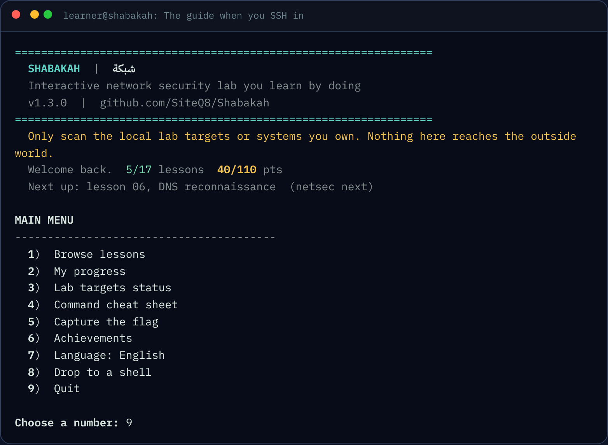
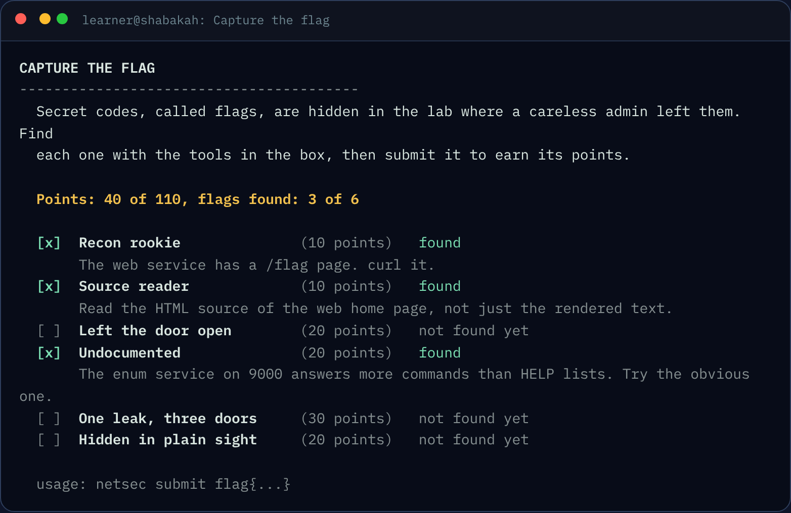
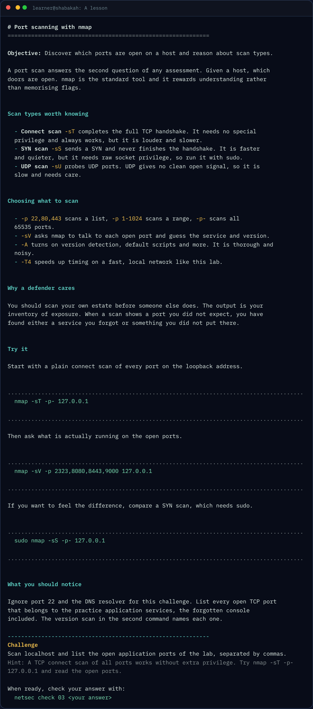
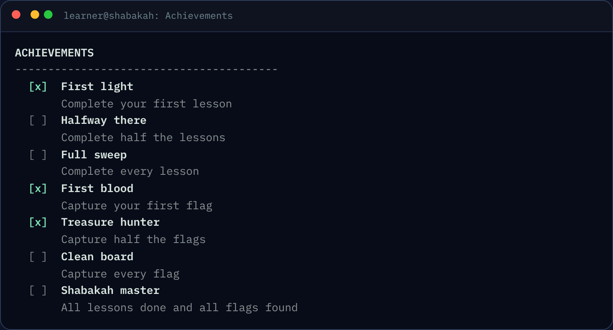

# Shabakah (شبكة)

A network security lab you SSH into to learn by doing.

[](https://github.com/SiteQ8/Shabakah/actions/workflows/docker-image.yml)
[](https://github.com/SiteQ8/Shabakah/releases)
[](LICENSE)
[](https://github.com/SiteQ8/Shabakah/pkgs/container/shabakah)

Shabakah is an isolated Docker lab that runs on your own machine. You start it,
you SSH in, and a bilingual guide walks you through <!--n:lessons-->17<!--/n--> hands on lessons
against real services running beside it. Every challenge is checked live, so you
learn by doing, not by reading. There is also a capture the flag hunt of
<!--n:flags-->6<!--/n--> secret flags worth <!--n:points-->110<!--/n--> points, and a set of achievements to earn. The practice
services listen on the loopback address inside the lab only, so you can practise
scanning, capture and enumeration without touching anyone else.

Built and maintained by Ali AlEnezi (SiteQ8). Available in English and Arabic.

Website: https://shabakah.3li.info



## Quick start

With Docker Compose:

```
git clone https://github.com/SiteQ8/Shabakah.git
cd Shabakah
docker compose up -d --build
ssh -p 2222 learner@localhost
```

The default password is `shabakah`. Change it with the `LEARNER_PASSWORD`
environment variable before using this anywhere shared.

Or pull the prebuilt image from the GitHub Container Registry. It is built for
both Intel and ARM machines, Apple Silicon included:

```
docker run -d --name shabakah --cap-add NET_ADMIN -p 2222:22 ghcr.io/siteq8/shabakah:latest
ssh -p 2222 learner@localhost
```

`NET_ADMIN` is only needed for the firewall lesson. Everything else works
without it.

## What is inside

A guide called `netsec` that carries every lesson, shows the objective and the
challenge, then verifies your answer against the running services in real time.
Your progress is saved between sessions, and `netsec next` always opens the
lesson you have not finished yet.

<!--n:targets-->6<!--/n--> live practice services, each one there so a lesson has something honest
to find, from a chatty web service to a forgotten cleartext console.

A capture the flag hunt: secret codes, called flags, are hidden where a careless
admin would leave them. Find each one with the tools in the box and submit it to
earn its points. Seven achievements unlock as you go, and a completion
certificate waits at the end.



## The lessons

Every lesson ends in a live challenge the guide checks for you. This table is
generated from the lesson files, so it always matches what the guide serves.

<!--table:en-->
| # | Lesson | Objective |
|---|---|---|
| 01 | [The network stack and sockets](https://github.com/SiteQ8/Shabakah/blob/main/lab/lessons/en/01-stack-and-sockets.md) | See how your host talks to the network and how to read what is listening. |
| 02 | [Reading the wire with tcpdump](https://github.com/SiteQ8/Shabakah/blob/main/lab/lessons/en/02-tcpdump.md) | Capture live traffic, apply a filter, and read what a request and reply contain. |
| 03 | [Port scanning with nmap](https://github.com/SiteQ8/Shabakah/blob/main/lab/lessons/en/03-nmap.md) | Discover which ports are open on a host and reason about scan types. |
| 04 | [Service enumeration and banners](https://github.com/SiteQ8/Shabakah/blob/main/lab/lessons/en/04-enumeration.md) | Talk to a service by hand and pull useful detail out of its responses. |
| 05 | [HTTP recon and cleartext exposure](https://github.com/SiteQ8/Shabakah/blob/main/lab/lessons/en/05-http-cleartext.md) | Inspect an HTTP service and see why cleartext protocols are dangerous. |
| 06 | [DNS reconnaissance](https://github.com/SiteQ8/Shabakah/blob/main/lab/lessons/en/06-dns.md) | Query different record types and understand what DNS reveals. |
| 07 | [TLS and certificates](https://github.com/SiteQ8/Shabakah/blob/main/lab/lessons/en/07-tls.md) | Inspect a TLS service, read its certificate, and judge its trust. |
| 08 | [Host firewalling](https://github.com/SiteQ8/Shabakah/blob/main/lab/lessons/en/08-firewall.md) | Read and reason about firewall rules and the default deny idea. |
| 09 | [Traffic analysis and spotting attacks](https://github.com/SiteQ8/Shabakah/blob/main/lab/lessons/en/09-traffic-analysis.md) | Recognise the shape of common activity, including a scan, in captured traffic. |
| 10 | [Detection and hardening](https://github.com/SiteQ8/Shabakah/blob/main/lab/lessons/en/10-defense.md) | Tie the lessons together into a defender mindset and a repeatable routine. |
| 11 | [UDP services and why they hide](https://github.com/SiteQ8/Shabakah/blob/main/lab/lessons/en/11-udp.md) | Scan and talk to a UDP service, and understand why UDP is easy to miss. |
| 12 | [Chaining findings into access](https://github.com/SiteQ8/Shabakah/blob/main/lab/lessons/en/12-loot-chain.md) | Follow a trail from one small leak to real access, the way a real assessment runs. |
| 13 | [Read a capture like an investigator](https://github.com/SiteQ8/Shabakah/blob/main/lab/lessons/en/13-pcap-forensics.md) | Open a saved packet capture and reconstruct what happened from the packets alone. |
| 14 | [Find the attack in the logs](https://github.com/SiteQ8/Shabakah/blob/main/lab/lessons/en/14-log-analysis.md) | Read an authentication log and pick out a brute force attempt and its source. |
| 15 | [Harden the door you came in through](https://github.com/SiteQ8/Shabakah/blob/main/lab/lessons/en/15-ssh-hardening.md) | Understand the settings that make an SSH server hard to attack, and see them in place. |
| 16 | [Reading security headers](https://github.com/SiteQ8/Shabakah/blob/main/lab/lessons/en/16-security-headers.md) | Read the HTTP response headers that tell a browser how to protect its users, and spot the ones that are missing. |
| 17 | [Scripted scanning with nmap](https://github.com/SiteQ8/Shabakah/blob/main/lab/lessons/en/17-nmap-scripts.md) | Use the Nmap Scripting Engine to pull titles, certificates and banners in one pass, and know which scripts are safe to run. |
<!--/table-->



## The practice services

| Port | Service | What it is for |
|------|---------|----------------|
| tcp 8080 | Cleartext web | A telling banner, hidden paths, and pages it should never expose |
| tcp 8443 | TLS web | The same service over TLS, with a self signed certificate and an incomplete set of security headers |
| tcp 9000 | Enumeration service | A chatty banner and an undocumented command to uncover |
| tcp 2323 | Cleartext console | A forgotten console that reuses a password |
| udp 5353 | Lab DNS resolver | An offline resolver for the shabakah.lab zone |
| udp 9001 | UDP banner service | A UDP service that stays silent until you speak its protocol |

## Capture the flag

```
netsec ctf                     show the board and your score
netsec ctf hint <flag-id>      show where a flag is hidden
netsec submit flag{...}        submit a flag you found
netsec achievements            show your badges
netsec certificate [name]      print your certificate once everything is done
```

Lesson 12 walks the full chain from one small leak to real access, so the hunt
doubles as a lesson in how a real assessment actually runs.



## Driving the guide

```
netsec                      open the interactive guide
netsec lessons              list all lessons
netsec lesson <id>          read one lesson
netsec next                 open the next unfinished lesson
netsec check <id> <answer>  check your challenge answer
netsec targets              show which practice services are up
netsec cheat                command cheat sheet
netsec progress             show your progress and score
netsec ctf                  show the capture the flag board
netsec submit flag{...}     submit a flag you found
netsec achievements         show your badges
netsec certificate [name]   print your completion certificate
netsec reset                erase your progress and start over
netsec lang [en|ar]         get or set the language
```

## The toolbox

The lab ships with a working network security kit so nothing needs installing
mid lesson: nmap with its scripting engine, tcpdump, ngrep, openssl, dig, whois,
netcat, socat, curl, wget, hping3, nftables, iptables, mtr, and traceroute.

## Safety

The practice services are weak on purpose, so they bind to the loopback address
inside the lab and only SSH is published. Never publish their ports to a real
network. An instructor who needs them reachable on the lab's own network
interface can set `SHABAKAH_BIND=0.0.0.0`, and should then keep the lab on an
isolated network. Only ever scan the lab targets or systems you own.

## For instructors

Run one lab per learner, each on its own host port, and set a password per lab
with `LEARNER_PASSWORD` or a public key with `SSH_PUBKEY`. Progress lives in the
learner's home directory inside the lab, and `netsec reset --yes` clears it for
the next class.

## Languages

Every lesson, prompt, hint and screen of the guide is written in both English
and Arabic. Switch any time with `netsec lang ar` or `netsec lang en`, or from
the menu, and your progress follows.

## Building and testing

```
docker build -t shabakah:latest .
docker run -d --name shabakah --cap-add NET_ADMIN -p 2222:22 shabakah:latest
```

The lab content lives under `lab/`. Lessons are markdown with a small front
matter block in `lab/lessons/<lang>/`. The guide is `lab/bin/netsec` and the
practice services are `lab/targets/targets.py`, both plain Python 3 with no
dependencies.

```
sh tests/smoke.sh                       guide and live checks, no Docker needed
python3 -m unittest discover -s tests   guide strings, Arabic rules, site sync
python3 tools/lint_lessons.py           lesson parity and Arabic house rules
python3 tools/build_site.py --check     site and README match the lessons
sh tests/e2e.sh                         full run inside the built image
```

Continuous integration runs all of these, then solves every lesson inside the
built image before it publishes anything.

## Contributing

New lessons, new targets, and translations are welcome. See CONTRIBUTING.md for
how the pieces fit together. To report a security issue, see SECURITY.md.

## License

MIT. See LICENSE. Built by Ali AlEnezi (SiteQ8).

---

## عن شبكة

شبكة مختبر مفتوح المصدر لأمن الشبكات يعمل في بيئة Docker معزولة على جهازك وحده، فتشغّله ثم تدخل إليه عبر SSH ليستقبلك مرشد بالعربية والإنجليزية ويسير بك في <!--ar:lesson_applied:lessons-->17 درسا تطبيقيا<!--/ar--> على خدمات حقيقية تعمل داخله، ويصحّح لك كل تمرين لحظة تنفيذه.

وإلى جانب الدروس خبّأنا في المختبر <!--ar:code:flags-->6 رموز سرية<!--/ar--> تكشفها بالأدوات الموجودة ثم تسلّمها لتجمع <!--ar:point:points-->110 نقاط<!--/ar-->، أي أنك تتدرّب على أسلوب التقاط الأعلام المعروف في الأمن السيبراني، وتنال في النهاية شهادة إتمام بالأمر `netsec certificate`.

### البدء

```
git clone https://github.com/SiteQ8/Shabakah.git
cd Shabakah
docker compose up -d --build
ssh -p 2222 learner@localhost
```

كلمة المرور الافتراضية `shabakah`، فغيّرها بالمتغير `LEARNER_PASSWORD` قبل أي استخدام مشترك، ثم بدّل لغة المرشد إلى العربية بالأمر `netsec lang ar`.

### الدروس

<!--table:ar-->
| الدرس | العنوان | الهدف |
|---|---|---|
| 01 | [طبقات الشبكة والمقابس](https://github.com/SiteQ8/Shabakah/blob/main/lab/lessons/ar/01-stack-and-sockets.md) | تعلّم كيف يتصل جهازك بالشبكة، وكيف تتعرّف على الخدمات التي تستمع على منافذه. |
| 02 | [التقاط الحزم وقراءتها باستخدام tcpdump](https://github.com/SiteQ8/Shabakah/blob/main/lab/lessons/ar/02-tcpdump.md) | التقط حركة الشبكة لحظة مرورها، وحدّد بمرشّح ما تريد الاحتفاظ به منها، ثم اقرأ ما يحمله الطلب والاستجابة. |
| 03 | [مسح المنافذ باستخدام nmap](https://github.com/SiteQ8/Shabakah/blob/main/lab/lessons/ar/03-nmap.md) | اكتشف المنافذ المفتوحة على الجهاز، وافهم الفرق بين أنواع المسح ومتى تستخدم كلا منها. |
| 04 | [تعداد الخدمات وقراءة لافتاتها](https://github.com/SiteQ8/Shabakah/blob/main/lab/lessons/ar/04-enumeration.md) | تواصل مع الخدمة يدويا، واستخلص من استجاباتها تفاصيل مفيدة. |
| 05 | [استطلاع خدمات HTTP ومخاطر النص الصريح](https://github.com/SiteQ8/Shabakah/blob/main/lab/lessons/ar/05-http-cleartext.md) | افحص خدمة HTTP، وتبيّن بنفسك خطورة البروتوكولات التي تنقل البيانات بنص صريح. |
| 06 | [الاستطلاع عبر نظام أسماء النطاقات](https://github.com/SiteQ8/Shabakah/blob/main/lab/lessons/ar/06-dns.md) | استعلم عن أنواع مختلفة من السجلات، وافهم ما يكشفه نظام أسماء النطاقات من معلومات. |
| 07 | [بروتوكول TLS والشهادات الرقمية](https://github.com/SiteQ8/Shabakah/blob/main/lab/lessons/ar/07-tls.md) | افحص خدمة تعمل ببروتوكول TLS واقرأ شهادتها، ثم احكم على مدى جدارتها بالثقة. |
| 08 | [الجدار الناري على مستوى المضيف](https://github.com/SiteQ8/Shabakah/blob/main/lab/lessons/ar/08-firewall.md) | اقرأ قواعد الجدار الناري وافهم منطقها، وتعرّف على فكرة المنع الافتراضي. |
| 09 | [تحليل حركة الشبكة ورصد الهجمات](https://github.com/SiteQ8/Shabakah/blob/main/lab/lessons/ar/09-traffic-analysis.md) | ميّز ملامح النشاط الشائع في حركة الشبكة الملتقطة، ومنها مسح المنافذ. |
| 10 | [الكشف والتحصين](https://github.com/SiteQ8/Shabakah/blob/main/lab/lessons/ar/10-defense.md) | اربط الدروس السابقة بعضها ببعض لتكوّن طريقة تفكير المدافع وخطوات ثابتة تعيدها على أي مضيف. |
| 11 | [خدمات UDP ولماذا تختبئ](https://github.com/SiteQ8/Shabakah/blob/main/lab/lessons/ar/11-udp.md) | افحص خدمة UDP وخاطبها وافهم لماذا يسهل تفويتها. |
| 12 | [ربط النتائج للوصول](https://github.com/SiteQ8/Shabakah/blob/main/lab/lessons/ar/12-loot-chain.md) | اتبع أثرا من تسريب صغير إلى وصول حقيقي كما يجري التقييم الواقعي. |
| 13 | [اقرأ الالتقاط كمحقق](https://github.com/SiteQ8/Shabakah/blob/main/lab/lessons/ar/13-pcap-forensics.md) | افتح ملف التقاط محفوظا وأعد بناء ما جرى من الحزم وحدها. |
| 14 | [اعثر على الهجوم في السجلات](https://github.com/SiteQ8/Shabakah/blob/main/lab/lessons/ar/14-log-analysis.md) | اقرأ سجل مصادقة والتقط محاولة تخمين شاملة ومصدرها. |
| 15 | [حصّن الباب الذي دخلت منه](https://github.com/SiteQ8/Shabakah/blob/main/lab/lessons/ar/15-ssh-hardening.md) | افهم الإعدادات التي تجعل خادم SSH صعب المهاجمة وشاهدها مطبقة. |
| 16 | [قراءة ترويسات الأمان](https://github.com/SiteQ8/Shabakah/blob/main/lab/lessons/ar/16-security-headers.md) | اقرأ ترويسات استجابة HTTP التي تخبر المتصفح كيف يحمي مستخدميه، واكتشف الغائب منها. |
| 17 | [الفحص بالبرامج النصية في nmap](https://github.com/SiteQ8/Shabakah/blob/main/lab/lessons/ar/17-nmap-scripts.md) | استخدم محرّك البرامج النصية في nmap لتستخرج عناوين الصفحات والشهادات ولافتات الخدمات في فحص واحد، واعرف البرامج النصية التي يمكن تشغيلها بأمان. |
<!--/table-->

### الأمان

ترتبط خدمات التدريب بعنوان الاسترجاع داخل المختبر فلا يصل إليها أحد من خارجه، ولذلك لا تنشر منافذها على شبكة حقيقية لأنها ضعيفة عمدا، واكتفِ بنشر منفذ SSH كما في ملف docker-compose.yml.

الموقع https://shabakah.3li.info، والترخيص MIT، ومن تطوير علي العنزي.
